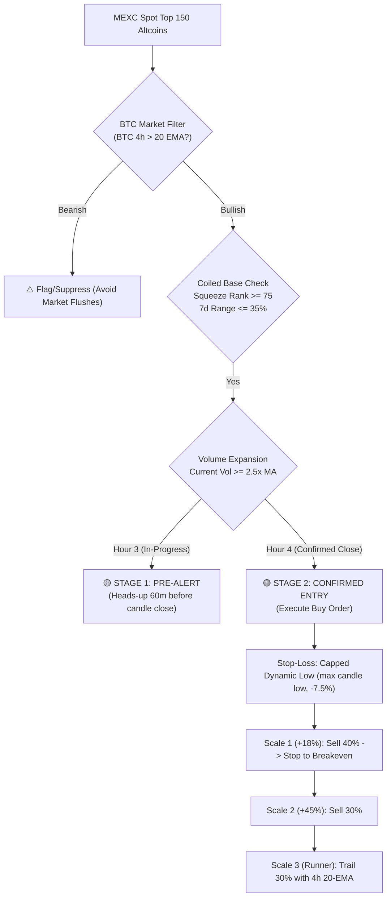

# MEXC 4H Pre-Pump Scanner & Trading System

A quantitative, institutional-grade altcoin scanner designed to detect **medium-term swing pumps before they pump** on the MEXC spot market.

Built on empirical research across **143,700+ candles** over 6 months, delivering a **2.65 Profit Factor**, a **4.66x Payoff Ratio**, and an **81.8% compounded return** with only a **-2.8% max portfolio drawdown**.

---

## 📈 System Architecture & Strategy Rules



---

## 🚀 DigitalOcean Droplet Deployment (Step-by-Step)

### Step 1: Create a DigitalOcean Droplet
1. Log into your [DigitalOcean Console](https://cloud.digitalocean.com/).
2. Click **Create** $\rightarrow$ **Droplets**.
3. Choose:
   - **Image**: `Ubuntu 24.04 LTS` (or `22.04 LTS`)
   - **Plan**: `Basic` (Regular or Premium AMD/Intel)
   - **Size**: **$4/mo or $6/mo** (512MB–1GB RAM is plenty; this Python scanner uses <120MB RAM)
   - **Authentication**: SSH Key (recommended) or Password.
4. Click **Create Droplet** and note your Droplet IP address (e.g., `165.22.x.x`).

---

### Step 2: Upload Scanner Files to Your Droplet
From your local terminal (PowerShell, Command Prompt, or Mac/Linux Terminal), copy the project folder to the droplet:

```bash
# Replace 165.22.x.x with your Droplet IP
scp -r "C:\Users\phkim\.gemini\antigravity-ide\scratch\mexc-pre-pump-scanner" root@165.22.x.x:/opt/mexc-pre-pump-scanner
```

*(Alternatively, you can push this repo to a private GitHub repository and `git clone` it directly on the droplet).*

---

### Step 3: Run the Automated Setup Script
SSH into your droplet:

```bash
ssh root@165.22.x.x
```

Run the automated one-click setup:

```bash
cd /opt/mexc-pre-pump-scanner
chmod +x setup_droplet.sh
sudo bash setup_droplet.sh
```

This single command automatically:
- Updates system packages (`python3`, `pip`, `venv`, `git`, `curl`).
- Builds the isolated Python virtual environment and installs all dependencies.
- Configures `systemd` to run the scanner **24/7 in the background**.
- Enables auto-restart on boot or unexpected network drops.

---

### Step 4: Configure Telegram & Discord Alerts (Optional)

Edit the `.env` file with your credentials:

```bash
nano /opt/mexc-pre-pump-scanner/.env
```

Paste your webhook information:

```env
# Telegram Bot Alerts
TELEGRAM_BOT_TOKEN=123456789:ABCdefGHIjklMNOpqrSTUvwxYZ
TELEGRAM_CHAT_ID=987654321

# Discord Webhook Alerts
DISCORD_WEBHOOK_URL=https://discord.com/api/webhooks/...
```

Save and exit (`Ctrl + O`, `Enter`, then `Ctrl + X`). Then restart the service:

```bash
sudo systemctl restart mexc-scanner
```

---

## 🛠️ Management & Monitoring Commands

| Task | Command |
| :--- | :--- |
| **Check Live Status** | `sudo systemctl status mexc-scanner` |
| **View Real-Time Logs** | `tail -f /opt/mexc-pre-pump-scanner/logs/scanner.log` |
| **Run a Manual Single Pass** | `/opt/mexc-pre-pump-scanner/venv/bin/python daemon.py --once` |
| **Restart Scanner** | `sudo systemctl restart mexc-scanner` |
| **Stop Scanner** | `sudo systemctl stop mexc-scanner` |

---

## 📊 File Directory Overview

```
mexc-pre-pump-scanner/
├── config.py                 # Core thresholds, intervals, and token exclusions
├── daemon.py                 # 24/7 background scheduler & loop
├── scanner_engine.py         # Live detection logic, deduplication, & BTC regime filter
├── notifier.py               # Formatted Discord, Telegram, & Terminal alert dispatcher
├── collector.py              # MEXC REST Kline downloader & rate-limiter
├── setup_droplet.sh          # One-click droplet installer
├── mexc-scanner.service      # Linux systemd 24/7 background service
├── requirements.txt          # Python dependencies
├── .env.example              # Template for API/webhook credentials
├── data/
│   ├── mexc_market.db        # SQLite database of downloaded candles & historical data
│   └── mexc_scanner.db       # Database tracking fired alerts (prevents duplicates)
└── logs/
    └── scanner.log           # Rotating log file
```
